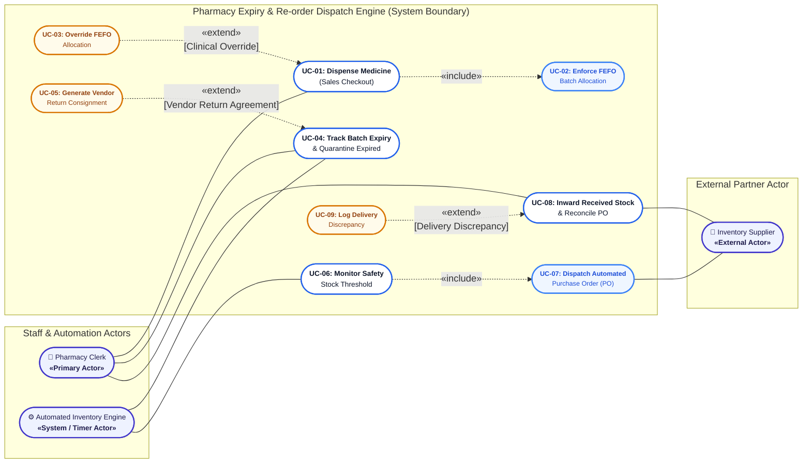
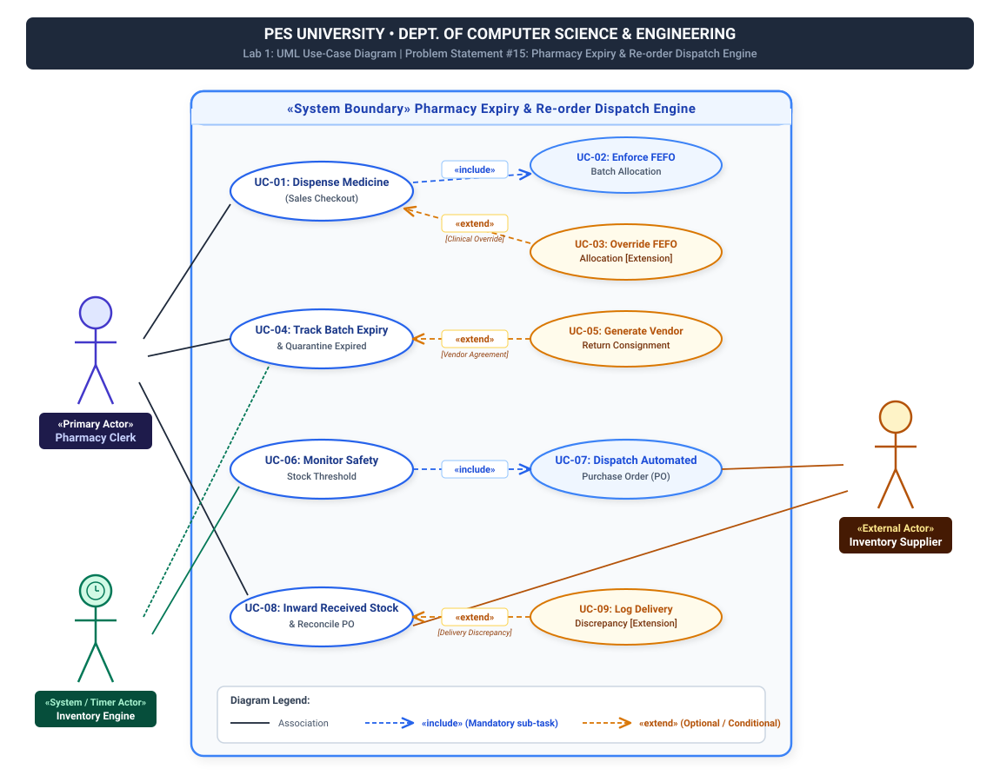

# PES University - Department of Computer Science & Engineering
## Lab 1: Requirements Engineering & UML Use-Case Modelling

---

### **Student & Project Metadata**
* **Institution:** PES University, Bengaluru
* **Department:** Department of Computer Science and Engineering
* **Course:** Object-Oriented Analysis & Design / Software Engineering (UE21CS301 / UE22CS351)
* **Domain:** Healthcare & Telemedicine
* **Problem Statement #15:** **Pharmacy Expiry & Re-order Dispatch Engine**
* **Target Stakeholders / Actors:** `Pharmacy Clerk`, `Inventory Supplier`, `Automated Inventory Engine`

---

## Table of Contents
1. [Problem Context & Overview](#1-problem-context--overview)
2. [Target Stakeholders & Actors](#2-target-stakeholders--actors)
3. [Complete Requirements Table](#3-complete-requirements-table)
   - [Functional Requirements (FR-001 to FR-005)](#31-functional-requirements-fr-001-to-fr-005)
   - [Non-Functional Requirements (NFR-001 & NFR-002)](#32-non-functional-requirements-nfr-001--nfr-002)
4. [UML Use-Case Diagram](#4-uml-use-case-diagram)
   - [Mermaid Diagram (Interactive)](#41-uml-diagram-mermaid)
   - [Vector Graphic Render (SVG)](#42-vector-diagram-svg)
   - [Use-Case Breakdown & Stereotypes](#43-use-case-inventory--stereotypes)
   - [«include» and «extend» Relationships](#44-include-and-extend-relationship-analysis)
5. [Use-Case Flow Specification (Core: UC-01)](#5-use-case-flow-specification-core-use-case)
   - [UC-01: Dispense Medicine with Automated FEFO Allocation](#use-case-id-uc-01)
   - [Supplementary Flow: UC-07 Purchase Order Dispatch](#supplementary-use-case-specification-uc-07)
6. [Repository Structure & GitHub Submission Guide](#6-repository-structure--github-submission-guide)

---

## 1. Problem Context & Overview

Hospital pharmacies operate at the critical nexus of patient safety, clinical efficacy, and operational economics. Modern medical facilities stock thousands of stock-keeping units (SKUs) of life-saving, acute, and chronic medications. Managing this inventory manually poses three severe vulnerabilities:

1. **Pharmaceutical Expiry Wastage:** Pharmacy shelves frequently witness older stock lingering behind newer replenishments. Failure to dispense older batches first results in expired medications that must be written off at immense financial cost.
2. **Patient Safety Violations:** Dispensing expired or degraded drugs due to manual cashier oversight during peak hospital triage or emergency hours causes severe clinical harm, malpractice litigation, and loss of accreditation.
3. **Emergency Medication Stockouts:** Delays in identifying stock depletion result in emergency room stockouts of critical drugs (e.g., adrenaline, insulin, antibiotics) before manual purchase orders can be prepared and delivered.

The **Pharmacy Expiry & Re-order Dispatch Engine** is an intelligent, mission-critical stock management engine engineered to automate batch expiration lifecycle tracking. It guarantees **First-Expired-First-Out (FEFO)** picking order during patient sales checkout, flags and quarantines near-expiry/expired stocks, and automatically triggers electronic purchase order dispatch to inventory suppliers when stock breaches safety thresholds.

---

## 2. Target Stakeholders & Actors

```
                 +-------------------------------------------------------+
                 |    Pharmacy Expiry & Re-order Dispatch Engine         |
                 +-------------------------------------------------------+
                    ^                                    ^
                    |                                    |
            [Primary Actor]                      [External Actor]
          +------------------+                +--------------------+
          |  Pharmacy Clerk  |                | Inventory Supplier |
          +------------------+                +--------------------+
                    ^
                    |
            [System Actor]
     +------------------------------+
     |  Automated Inventory Engine  |
     +------------------------------+
```

1. **Pharmacy Clerk (Primary Actor - Human):** Frontline pharmacy staff operating checkout terminals. Dispenses medications, reviews automated FEFO batch allocations, scans physical boxes, and logs newly received shipments from suppliers.
2. **Inventory Supplier (Secondary / External Actor - Organization / System):** Contracted pharmaceutical vendor/distributor. Interacts via automated electronic interfaces (REST API / EDI) to receive purchase orders and physically fulfills batch deliveries.
3. **Automated Inventory Engine (System / Timer Actor - Internal Daemon):** Background system service executing continuous threshold monitoring, midnight expiry scans, stock quarantining, and purchase order dispatches.

---

## 3. Complete Requirements Table

### 3.1 Functional Requirements (FR-001 to FR-005)

| Requirement ID | Type | Description | Priority | Acceptance Criteria | Rationale |
| :---: | :---: | :--- | :---: | :--- | :--- |
| **FR-001** | Functional (Stock Dispensing) | The system shall enforce First-Expired-First-Out (FEFO) picking logic by automatically selecting and allocating medicine batches with the earliest valid expiry date during sales checkout and billing. | **High** | **Pass:** Oldest valid batch selected first; if quantity exceeds batch, subsequent units are drawn from the next earliest unexpired batch.<br/>**Fail:** Newer batch assigned while older unexpired batch of identical SKU exists in active stock. | Prevents drug spoilage on shelves, eliminates financial write-offs, and guarantees older safe medications are utilized prior to newly delivered stock. |
| **FR-002** | Functional (Quality Assurance) | The system shall continuously track batch expiration dates, issue proactive visual alerts for batches nearing expiry ($\le 30$ days), and automatically lock expired batches into a quarantined state preventing checkout. | **High** | **Pass:** Batches $\le 30$ days to expiry trigger dashboard alerts; at 00:00:00 on expiry date, batch state flips to `QUARANTINED` and blocks checkout selection.<br/>**Fail:** Expired medicines remain selectable/billable at checkout, or near-expiry batches trigger no warning alerts. | Guarantees patient safety by eradicating accidental dispensing of expired medications and ensures compliance with FDA/CDSCO regulations. |
| **FR-003** | Functional (Inventory Control) | The system shall continuously calculate aggregate usable unexpired stock for each drug SKU and automatically trigger a purchase order request when available stock breaches the defined safety threshold. | **High** | **Pass:** When unexpired inventory $\le$ safety threshold following any sale or adjustment, SKU status updates to `REORDER_TRIGGERED` and dispatches event in $\le 5$s.<br/>**Fail:** Stock breaches threshold without triggering re-order generation, or re-order is falsely triggered when stock is above safety threshold. | Prevents life-threatening stockouts of essential and emergency medications in the hospital, ensuring continuous therapeutic availability. |
| **FR-004** | Functional (Procurement & Integration) | The system shall automatically compile triggered re-order specifications into standardized digital Purchase Orders (PO) and securely transmit them electronically (EDI/API) to the designated Inventory Supplier. | **Medium** | **Pass:** Electronic PO containing unique PO-ID, SKU, quantity, and delivery parameters is transmitted and acknowledged by supplier endpoint (`HTTP 200 OK`).<br/>**Fail:** PO is generated with missing mandatory fields (SKU, quantity, vendor ID), or transmission failure fails to retry and alert staff. | Eliminates human procurement paperwork delays, avoids error-prone manual data entry, and accelerates order replenishment lead times. |
| **FR-005** | Functional (Inwarding & Reconciliation) | The system shall allow the Pharmacy Clerk to log incoming stock consignments delivered by the Inventory Supplier, verifying batch numbers, manufacturing dates, expiry dates, and received quantities against the active Purchase Order before activating stock. | **High** | **Pass:** Clerk confirms matching shipment; system generates new batch ledger entries with verified expiry dates, increments stock, and marks PO as `FULFILLED`.<br/>**Fail:** System allows stock inwarding without entering mandatory batch/expiry dates, or closes PO without logging delivery count discrepancies. | Maintains an unbroken chain of custody, guarantees traceability from supplier to patient, and prevents counterfeit or unverified drugs from entering inventory. |

---

### 3.2 Non-Functional Requirements (NFR-001 & NFR-002)

| Requirement ID | Type | Description | Priority | Acceptance Criteria | Rationale |
| :---: | :---: | :--- | :---: | :--- | :--- |
| **NFR-001** | Performance & Scalability | The system shall execute real-time FEFO batch allocation queries within 500 milliseconds under a concurrent workload of 100 checkout terminals, and dispatch automated POs within 3 seconds of threshold breach. | **High** | **Pass:** Load testing under 100 concurrent checkout sessions demonstrates 95th percentile ($P_{95}$) latency $\le 500\text{ ms}$; PO dispatch latency $\le 3.0\text{ seconds}$.<br/>**Fail:** Batch allocation response time $> 1000\text{ ms}$, or PO dispatch drops/delays beyond $10\text{ seconds}$ during peak hours. | Hospital outpatient counters experience intense patient rushes; sub-second query latency prevents terminal freezing, long queues, and patient dissatisfaction. |
| **NFR-002** | Security & Audit Compliance | The system shall enforce Role-Based Access Control (RBAC), encrypt inventory and supplier transactions at rest (AES-256) and in transit (TLS 1.3), and generate an immutable, tamper-evident audit trail for all stock transactions. | **High** | **Pass:** Unauthorized users attempting FEFO overrides or batch alterations receive `HTTP 403 Forbidden`; all stock modifications generate cryptographically signed audit logs.<br/>**Fail:** Any user can modify batch expiration dates or delete audit records without administrator credentials and verifiable cryptographic logging. | Healthcare compliance standards (FDA 21 CFR Part 11, HIPAA, Good Pharmacy Practice) require non-repudiation and strict protection against batch falsification. |

---

## 4. UML Use-Case Diagram

### 4.1 UML Diagram (Mermaid)



---

### 4.2 Vector Diagram (SVG)

A publication-grade vector graphic version is located at [`diagrams/use_case_diagram.svg`](diagrams/use_case_diagram.svg).

<div align="center">
  
</div>

---

### 4.3 Use-Case Inventory & Stereotypes

| Use Case ID | Use Case Name | Primary Initiator | Stereotype / Category |
| :---: | :--- | :--- | :--- |
| **UC-01** | Dispense Medicine (Sales Checkout) | Pharmacy Clerk | Core Base Use Case |
| **UC-02** | Enforce FEFO Batch Allocation | Internal Invocation | `«include»` of UC-01 |
| **UC-03** | Override FEFO Allocation | Pharmacy Clerk / Supervisor | `«extend»` of UC-01 |
| **UC-04** | Track Batch Expiry & Quarantine Expired | Automated Engine / Clerk | Core Monitoring Use Case |
| **UC-05** | Generate Vendor Return Consignment | Pharmacy Clerk | `«extend»` of UC-04 |
| **UC-06** | Monitor Safety Stock Threshold | Automated Engine | Core Evaluation Use Case |
| **UC-07** | Dispatch Automated Purchase Order (PO) | Internal Invocation | `«include»` of UC-06 |
| **UC-08** | Inward Received Stock & Reconcile PO | Pharmacy Clerk & Supplier | Core Logistics Use Case |
| **UC-09** | Log Delivery Discrepancy | Pharmacy Clerk | `«extend»` of UC-08 |

---

### 4.4 «include» and «extend» Relationship Analysis

#### 1. «include» Relationships (Mandatory Inclusion)
* **`UC-01: Dispense Medicine` $\xrightarrow{\text{«include»}}$ `UC-02: Enforce FEFO Batch Allocation`**
  * *Specification:* The sales checkout process unconditionally requires batch allocation. The clerk cannot proceed to billing without the engine sorting and allocating units from the earliest unexpired batch.
* **`UC-06: Monitor Safety Stock Threshold` $\xrightarrow{\text{«include»}}$ `UC-07: Dispatch Automated Purchase Order (PO)`**
  * *Specification:* When the inventory engine evaluates that post-transaction stock $\le$ safety stock, it mandatorily triggers and executes the automated purchase order dispatch routine.

#### 2. «extend» Relationships (Conditional Extension)
* **`UC-03: Override FEFO Allocation` $\xrightarrow{\text{«extend»}}$ `UC-01: Dispense Medicine`**
  * *Extension Point:* `[Clinical Override]`
  * *Condition:* Executed only when a physician or supervisor explicitly mandates a specific batch formulation (e.g., pediatric concentration or clinical trial) and supplies cryptographic administrative authorization.
* **`UC-05: Generate Vendor Return Consignment` $\xrightarrow{\text{«extend»}}$ `UC-04: Track Batch Expiry & Quarantine Expired`**
  * *Extension Point:* `[Vendor Return Agreement Valid]`
  * *Condition:* Executed only when identified near-expiry or quarantined batches qualify for vendor credit return under the supplier contract SLA.
* **`UC-09: Log Delivery Discrepancy` $\xrightarrow{\text{«extend»}}$ `UC-08: Inward Received Stock & Reconcile PO`**
  * *Extension Point:* `[Delivery Discrepancy]`
  * *Condition:* Executed only when incoming physical goods exhibit quantity shortfalls, physical package damage, or incorrect expiration dates against the purchase order.

---

## 5. Use-Case Flow Specification (Core Use Case)

### Use Case ID: UC-01
### Use Case Name: Dispense Medicine with Automated FEFO Allocation

* **System:** Pharmacy Expiry & Re-order Dispatch Engine
* **Primary Actor:** Pharmacy Clerk
* **Secondary Actors:** Automated Inventory Engine, Hospital Billing System
* **Stakeholders:** Pharmacy Clerk, Hospital Pharmacist / Quality Head, Patients

---

### 5.1 Preconditions
1. The Pharmacy Clerk is authenticated and logged into an active POS counter session.
2. The requested medication SKU is active and cataloged in the master drug database.
3. At least one unexpired, non-quarantined batch of the medication exists in stock.
4. Barcode scanner and checkout peripherals are connected and responsive.

---

### 5.2 Postconditions
* **Success End Condition:**
  1. The requested quantity is allocated and deducted from the earliest unexpired batch(es) in strict chronological FEFO sequence.
  2. Itemized sales receipt and drug dispensing labels (with batch number and expiry date) are printed.
  3. Real-time active inventory balance is updated in the database.
  4. If usable inventory falls below the safety stock threshold, a re-order dispatch event is automatically triggered (`UC-06 / UC-07`).
  5. An immutable audit record is committed to the regulatory audit log (`NFR-002`).
* **Failure End Condition:**
  1. No inventory is deducted, no sale is billed, and stock counts remain unaltered.
  2. The system renders an explanatory alert (e.g., "Insufficient Unexpired Units", "Item Quarantined").

---

### 5.3 Main Success Scenario (Basic Flow)

| Step | Actor Action | System Response |
| :---: | :--- | :--- |
| **1** | Pharmacy Clerk inputs or scans the medication Item Code (SKU) and enters the required quantity. | System validates SKU and queries all active inventory batches for that medicine. |
| **2** | — | System filters out all batches past expiration date or flagged as quarantined (`<<include>> UC-04`). |
| **3** | — | System invokes the FEFO sorting engine (`<<include>> UC-02`), ordering valid unexpired batches chronologically by expiration date (`ASC`). |
| **4** | — | System allocates the requested units from the batch with the nearest valid expiration date having sufficient stock. |
| **5** | — | System displays the dispensing pick list on the clerk's screen: Medicine Name, Allocated Batch ID, Expiry Date, Storage Rack Code, Unit Price, and Line Total. |
| **6** | Pharmacy Clerk retrieves the medication box from the indicated shelf and scans the physical box barcode. | System verifies that the physical barcode matches the system-allocated FEFO batch ID. |
| **7** | Pharmacy Clerk confirms item addition to the patient's checkout cart. | System computes subtotal, applies hospital discounts, and updates cart total. |
| **8** | Pharmacy Clerk finalizes checkout and confirms patient payment. | System locks allocated batch stock, records the sale invoice, and generates printed dispensing labels. |
| **9** | — | System commits database transaction, decrementing active stock for the allocated batch. |
| **10** | — | System computes post-transaction unexpired stock against the safety threshold (`<<include>> UC-06`). |
| **11** | Pharmacy Clerk hands medication to patient with dosage directions. | System closes cart and returns to ready state for the next patient. |

---

### 5.4 Alternate Flows

#### Alternate Flow A: Multi-Batch Split Allocation under FEFO
* **Condition:** At **Step 4**, the earliest unexpired batch contains fewer units than the requested quantity, but cumulative unexpired stock across multiple batches is sufficient.
  * **A1.** System allocates all available stock from the earliest unexpired batch.
  * **A2.** System calculates the remaining balance and allocates units from the next chronologically earliest unexpired batch.
  * **A3.** System repeats the allocation sequence until the total requested quantity is fulfilled.
  * **A4.** System renders a split-batch pick list on the clerk's display, indicating exact unit counts and shelf locations for each respective batch.
  * **A5.** Pharmacy Clerk retrieves both boxes and scans each physical batch barcode.
  * **A6.** Flow rejoins the **Main Success Scenario at Step 7**.

#### Alternate Flow B: Clinical FEFO Override (`<<extend>> UC-03`)
* **Extension Point:** `[Clinical Override]` at **Step 5**.
* **Condition:** Attending physician mandates a specific batch formulation (e.g., pediatric formulation or clinical research study), requiring bypass of the automated FEFO assignment.
  * **B1.** Pharmacy Clerk clicks "Request Clinical Batch Override" and selects the designated alternate batch.
  * **B2.** System prompts for Head Pharmacist / Supervisor authorization credentials.
  * **B3.** Supervisor inputs administrative PIN and enters a mandatory clinical override justification.
  * **B4.** System validates credentials and confirms the requested batch is unexpired and non-quarantined.
  * **B5.** System assigns the selected batch, creates a high-priority entry in the tamper-evident audit log (`NFR-002`), and updates the pick display.
  * **B6.** Flow rejoins the **Main Success Scenario at Step 6**.

---

### 5.5 Exception Flows

#### Exception Flow E1: Stock Exhausted / Out of Stock
* **Condition:** At **Step 2**, the system finds zero unexpired units for the requested medication SKU.
  * **E1.1.** System displays alert: *"Stock Depleted: No unexpired units available for this SKU"*.
  * **E1.2.** System searches and displays therapeutically equivalent generic substitutes currently in stock.
  * **E1.3.** System triggers an urgent stockout alert to the automated procurement engine.
  * **E1.4.** Item is removed from the active cart; Clerk notifies the patient or selects an approved substitute.

#### Exception Flow E2: Physical Batch Barcode Mismatch
* **Condition:** At **Step 6**, the physical barcode scanned by the clerk does not match the system's FEFO-allocated batch ID.
  * **E2.1.** System sounds an audible warning and displays error modal: *"Batch Mismatch! Scanned box does not match FEFO allocation"*.
  * **E2.2.** System highlights the designated rack location and required batch ID again.
  * **E2.3.** The clerk returns the incorrect box and rescans the correct physical batch.
  * **E2.4.** Flow restarts from **Step 6**.

---

### Supplementary Use Case Specification: UC-07
#### Automated Purchase Order (PO) Generation & Supplier Dispatch

* **Primary Actor:** Automated Inventory Engine
* **Secondary Actor:** Inventory Supplier
* **Trigger:** Available usable stock $\le$ Safety Re-order Threshold post-transaction (`UC-06`).
* **Main Success Scenario:**
  1. Inventory Engine detects that total usable stock for SKU $\le$ Safety Threshold.
  2. System checks the vendor catalog and retrieves primary contracted supplier details for the SKU.
  3. System calculates optimal re-order quantity based on standard batch pack size and average daily consumption.
  4. System generates a standardized electronic Purchase Order (PO) with unique PO number, item SKU, quantity, price, and hospital delivery address.
  5. System transmits the PO payload via encrypted TLS 1.3 REST API request to the Inventory Supplier's procurement endpoint (`NFR-002`).
  6. Supplier system processes the payload, verifies order parameters, and returns an `HTTP 200 OK` acknowledgment with a Vendor Reference Number and estimated delivery date.
  7. System logs receipt of acknowledgment, updates PO status to `ACKNOWLEDGED`, and alerts the Pharmacy Clerk on the dashboard.
* **Alternate Flow (Supplier Timeout):** If supplier endpoint fails to respond within 5 seconds, system retries with exponential backoff (1m, 5m, 15m). If all retries fail, system sends an encrypted fallback email with the PO PDF attached and alerts the pharmacy manager.

---

## 6. Repository Structure & GitHub Submission Guide

### 6.1 Directory Layout
```
pharmacy-expiry-reorder-engine/
├── README.md                          # Primary comprehensive Lab 1 report
├── docs/
│   ├── REQUIREMENTS.md                # Formal requirements matrix (FR-001 to FR-005, NFR-001/002)
│   ├── USE_CASE_SPECIFICATION.md      # Detailed 1-page Use-Case flow specifications
│   └── USE_CASE_DIAGRAM.md            # UML model documentation, actor analysis & relationships
├── diagrams/
│   ├── use_case_diagram.svg           # High-resolution vector UML Use Case diagram
│   ├── use_case_diagram.puml          # PlantUML diagram source code
│   └── use_case_diagram.mmd           # Mermaid diagram source code
└── scripts/
    └── generate_svg.py                # Python script to render standards-compliant SVG
```

---

### 6.2 Steps to Push to Your Personal GitHub Account

Follow these quick terminal commands to push this project to your GitHub account for assignment submission:

1. **Create a New Repository on GitHub:**
   - Log into [GitHub](https://github.com).
   - Click **New Repository** (e.g., named `pharmacy-expiry-reorder-engine` or `pes-cse-lab1-pharmacy-engine`).
   - Keep it **Public** (or Private with teacher added as collaborator), and do not initialize with a README (this repository already has everything configured).

2. **Connect and Push from Your Terminal:**
   ```bash
   # Navigate to the project directory
   cd /Users/mrudul1206/.gemini/antigravity/scratch/pharmacy-expiry-reorder-engine

   # Link your GitHub repository (replace with your GitHub username & repo name)
   git remote add origin https://github.com/<YOUR_GITHUB_USERNAME>/pharmacy-expiry-reorder-engine.git

   # Set branch to main and push
   git branch -M main
   git push -u origin main
   ```

3. **Verify Submission:**
   - Open your GitHub repository URL in your web browser.
   - Verify that the `README.md` displays the requirements table, the interactive Mermaid UML diagram, and the use case specification cleanly.
   - Copy your GitHub repository URL and paste it into the PESU Lab 1 submission portal.

---
**PES University - Department of Computer Science & Engineering**  
*Problem Statement #15: Pharmacy Expiry & Re-order Dispatch Engine | Lab 1 Solution*
