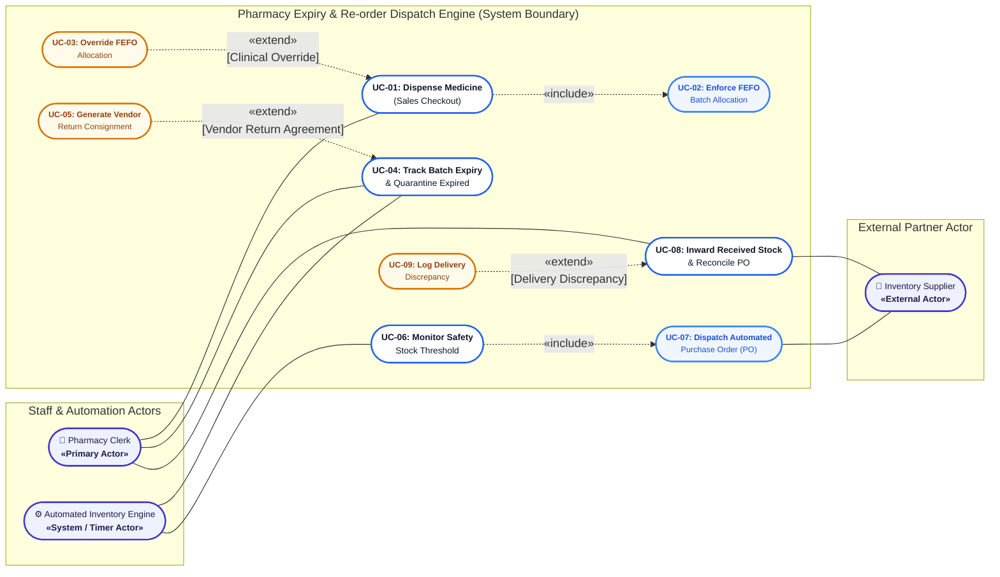

# UML Use-Case Diagram Documentation

**Institution:** PES University, Bengaluru  
**Department:** Department of Computer Science and Engineering  
**Course:** Object-Oriented Analysis & Design / Software Engineering (Lab 1)  
**Domain:** Healthcare & Telemedicine  
**Problem Statement #15:** Pharmacy Expiry & Re-order Dispatch Engine  

---

## 1. Visual Diagram

GitHub supports native Mermaid diagrams. The diagram below renders automatically on GitHub. A standalone vector SVG version is also available in [`diagrams/use_case_diagram.svg`](../diagrams/use_case_diagram.svg).

---

## 2. Actors Specification

| Actor Name | Actor Category | Role & Interaction Description |
| :--- | :--- | :--- |
| **Pharmacy Clerk** | Primary Actor (Human) | The frontline hospital pharmacy staff responsible for interacting with the POS counter, scanning item barcodes, reviewing system-suggested FEFO batches, retrieving physical items, handing medications to patients, and inwarding incoming consignments. |
| **Inventory Supplier** | Secondary / External Actor (Organization / External System) | The commercial pharmaceutical vendor or manufacturer contracted by the hospital. Interacts electronically to receive automated Purchase Orders (POs), returns order acknowledgments, and physically supplies replenishment batches with delivery documentation. |
| **Automated Inventory Engine** | System / Timer Actor (Internal Daemon) | The automated background service executing continuous or scheduled cron jobs. Responsible for midnight batch expiry audits, quarantining expired stock, evaluating safety stock threshold breaches post-checkout, and initiating automated electronic PO dispatch. |

---

## 3. Use Cases Summary

| Use Case ID | Use Case Title | Initiating Actor | Purpose / Description |
| :---: | :--- | :--- | :--- |
| **UC-01** | Dispense Medicine (Sales Checkout) | Pharmacy Clerk | Executes counter sales, retrieves customer prescriptions, looks up SKU, displays FEFO-selected batches, and records invoices. |
| **UC-02** | Enforce FEFO Batch Allocation | Included by UC-01 | Automatically sorts active unexpired batches by earliest expiry date and selects units in strict chronological expiration order. |
| **UC-03** | Override FEFO Allocation | Extends UC-01 | Allows authorized clinical staff to manually select an alternative batch under certified physician instructions or clinical trials. |
| **UC-04** | Track Batch Expiry & Quarantine Expired | Automated Engine / Clerk | Scans all batch records continuously, flags near-expiry medicines, and locks expired batches to prevent inadvertent sales. |
| **UC-05** | Generate Vendor Return Consignment | Extends UC-04 | Compiles quarantined or near-expiry batches into vendor return notes for credit or replacement according to supplier SLA. |
| **UC-06** | Monitor Safety Stock Threshold | Automated Engine / Clerk | Computes unexpired stock post-transaction; verifies if aggregate balance is $\le$ defined safety re-order threshold. |
| **UC-07** | Dispatch Automated Purchase Order (PO) | Included by UC-06 | Formats purchase specifications into an electronic order payload and transmits it directly to the contracted Inventory Supplier. |
| **UC-08** | Inward Received Stock & Reconcile PO | Pharmacy Clerk & Supplier | Inspects received goods against the open purchase order, logs new batch numbers and expiry dates, and activates active inventory. |
| **UC-09** | Log Delivery Discrepancy | Extends UC-08 | Captures short shipments, damaged containers, or unapproved expiration dates, notifying supplier for rectification. |

---

## 4. Modeling UML Relationships: `«include»` & `«extend»`

To strictly adhere to Lab 1 requirements and UML 2.5 standards:

### 4.1 «include» Relationships (Mandatory Sub-flows)
An **`«include»`** relationship denotes that the execution of the base use case **unconditionally and mandatorily** incorporates the behavior of the included use case. The dashed arrow points from the base use case to the included use case:

1. **`UC-01: Dispense Medicine` $\xrightarrow{\text{«include»}}$ `UC-02: Enforce FEFO Batch Allocation`**
   * *Rationale:* Every sales checkout transaction must determine the batch allocation. The clerk cannot complete dispensing without the system calculating and enforcing the First-Expired-First-Out picking logic.
2. **`UC-06: Monitor Safety Stock Threshold` $\xrightarrow{\text{«include»}}$ `UC-07: Dispatch Automated Purchase Order (PO)`**
   * *Rationale:* When the system determines that stock has breached safety thresholds, it mandatorily initiates and dispatches an automated purchase order to the vendor without manual human intervention.

### 4.2 «extend» Relationships (Optional / Conditional Flows)
An **`«extend»`** relationship models optional, conditional, or exceptional behavior that is inserted into the base use case only if a specific condition is met at an **Extension Point**. The dashed arrow points from the extending use case to the base use case:

1. **`UC-03: Override FEFO Allocation` $\xrightarrow{\text{«extend»}}$ `UC-01: Dispense Medicine`**
   * *Extension Point:* `[Clinical Override]`
   * *Condition:* The attending physician or head pharmacist explicitly requests a specific manufacturing batch (e.g. for pediatric dosage form or ongoing clinical trial) and provides cryptographic supervisor authentication.
2. **`UC-05: Generate Vendor Return Consignment` $\xrightarrow{\text{«extend»}}$ `UC-04: Track Batch Expiry & Quarantine Expired`**
   * *Extension Point:* `[Vendor Return Agreement Valid]`
   * *Condition:* Quarantined batches have contractual return/credit clauses with the respective supplier permitting return within 45 days of expiration.
3. **`UC-09: Log Delivery Discrepancy` $\xrightarrow{\text{«extend»}}$ `UC-08: Inward Received Stock & Reconcile PO`**
   * *Extension Point:* `[Delivery Discrepancy]`
   * *Condition:* The received shipment contains damaged units, quantity shortages, or invalid/near-expiry dates compared to the dispatched purchase order.
